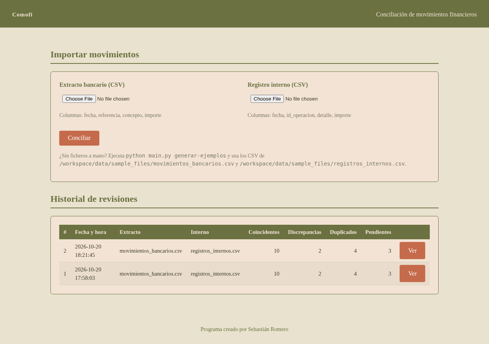
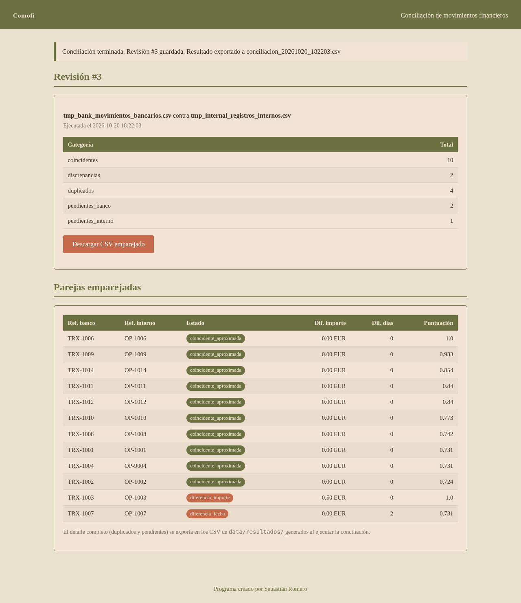
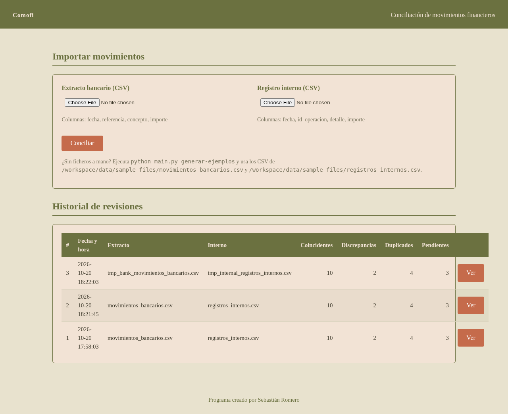

# Comofi — Conciliación de movimientos financieros

Aplicación que importa dos archivos CSV (por ejemplo, **movimientos bancarios** y **registros internos**) y detecta automáticamente:

- **Operaciones coincidentes** entre ambos orígenes.
- **Diferencias de importe o de fecha** entre pares emparejados.
- **Movimientos duplicados** dentro de cada origen.
- **Transacciones pendientes de conciliación** (sin contrapartida).
- **Historial de revisiones** guardado en SQLite y **exportación de resultados** a CSV.

Pensada para bancos, operaciones, back office, análisis de datos y desarrollo de sistemas financieros. Usa únicamente **datos ficticios**: no necesita acceso a información bancaria real ni a sistemas de un banco.

Programa creado por Sebastián Romero.

---

## Capturas de pantalla

### Portada: importación de CSV e historial de revisiones



### Detalle de una revisión: coincidencias, discrepancias, duplicados y pendientes



### Portada tras ejecutar una conciliación (aviso de resultado e historial actualizado)



### Salida por línea de órdenes

```text
=== Resumen de conciliación ===
coincidentes             10
discrepancias             2
duplicados                4
pendientes_banco          2
pendientes_interno        1

--- Discrepancias ---
[diferencia_importe] banco TRX-1003 (2026-03-03 / -1200.00) vs interno OP-1003 (2026-03-03 / -1200.50) | dif importe +0.50 | dif días 0
[diferencia_fecha] banco TRX-1007 (2026-03-06 / 980.00) vs interno OP-1007 (2026-03-08 / 980.00) | dif importe +0.00 | dif días 2

--- Duplicados ---
[banco] x2 -> 2026-03-11 | -300.00 EUR | Reintegro efectivo caja fuerte
[interno] x2 -> 2026-03-11 | -300.00 EUR | Reintegro caja chica

--- Pendientes de conciliación ---
Banco sin contrapartida interna (2):
  2026-03-05 TRX-1005 Comision mantenimiento cuenta -15.00
  2026-03-12 TRX-1013 Comision transferencia internacional 8.50
Interno sin contrapartida bancaria (1):
  2026-03-14 OP-1015 Anticipo cliente Zeta SL 3000.00
```

---

## Estructura del proyecto

```text
comofi/
  config.py        # Constantes y parámetros ajustables (tolerancias, pesos, rutas)
  csv_loader.py    # Lectura y validación de CSV (fechas es/EU, importes "1.234,56")
  reconciler.py    # Motor de conciliación (emparejamiento exacto y aproximado)
  history.py       # Historial de revisiones en SQLite
  exporter.py      # Exportación a CSV consolidado y por categoría
  samples.py       # Generador de CSV ficticios de ejemplo
  web.py           # Interfaz web (Flask)
templates/         # Plantillas HTML de la interfaz (estilo corporativo/earthy)
data/sample_files/ # CSV de ejemplo generados
main.py            # Punto de entrada por línea de órdenes
```

## Requisitos

- Python 3.10 o superior.
- `pandas` y `Flask` (ver `requirements.txt`).

## Instalación

```bash
git clone <url-del-repositorio> comofi
cd comofi
python -m venv .venv
source .venv/bin/activate        # En Windows: .venv\Scripts\activate
pip install -r requirements.txt
```

## Uso

### 1. Generar los CSV ficticios de ejemplo

```bash
python main.py generar-ejemplos
```

Crea `data/sample_files/movimientos_bancarios.csv` y `data/sample_files/registros_internos.csv` con casos sembrados a propósito: coincidencias limpias, una diferencia de importe, una diferencia de fecha, duplicados gemelos y movimientos sin contrapartida.

### 2. Conciliar por línea de órdenes

```bash
python main.py conciliar data/sample_files/movimientos_bancarios.csv data/sample_files/registros_internos.csv
```

Muestra el resumen en consola, guarda la revisión en el historial y exporta los resultados a `data/resultados/`.

### 3. Consultar el historial de revisiones

```bash
python main.py historial
```

### 4. Interfaz web

```bash
python main.py web        # http://127.0.0.1:5000
```

- Sube los dos CSV y pulsa **Conciliar**.
- Consulta el detalle de cada revisión: coincidencias, discrepancias, duplicados y pendientes.
- Descarga el CSV de cualquier revisión desde su página de detalle.
- Endpoint de comprobación: `GET /salud`.

## Formato esperado de los CSV

**Movimientos bancarios** (cabeceras obligatorias):

```csv
fecha,referencia,concepto,importe
03/03/2026,TRX-1003,Alquiler oficina marzo,-1200,00
```

**Registros internos** (cabeceras obligatorias):

```csv
fecha,id_operacion,detalle,importe
03/03/2026,OP-1003,Alquiler oficina,-1200,50
```

Notas de lectura:

- Fechas aceptadas: `dd/mm/yyyy`, `yyyy-mm-dd` o `dd-mm-yyyy`.
- Importes en formato europeo (`1.234,56`) o estándar (`1234.56`).
- Las cabeceras se validan al importar; si falta alguna, la app informa del error concreto.

## Cómo decide la aplicación cada categoría

| Categoría | Criterio |
|---|---|
| Coincidente | Referencia idéntica, o similitud de importe y concepto por encima del umbral configurado, con fechas dentro de la ventana máxima. |
| Diferencia de importe | Par emparejado cuya diferencia absoluta supera la tolerancia de céntimos. |
| Diferencia de fecha | Par emparejado cuyas fechas difieren más de lo permitido por la tolerancia diaria. |
| Duplicado | Dos o más filas con la misma fecha, importe y concepto dentro del mismo origen. |
| Pendiente | Movimiento que no encuentra contrapartida en el otro origen tras las dos pasadas de emparejamiento. |

Todos los umbrales viven en `comofi/config.py` (por ejemplo, `AMOUNT_TOLERANCE`, `DAYS_WINDOW`, `FUZZY_MIN_SCORE`, `WEIGHT_AMOUNT`, `WEIGHT_CONCEPT`). No hay valores quemados en la lógica.

## Exportación de resultados

Cada conciliación genera en `data/resultados/`:

- `conciliacion_<marca_temporal>.csv` — consolidado con todas las categorías.
- `..._coincidentes.csv`, `..._discrepancias.csv`, `..._duplicados.csv`, `..._pendientes_banco.csv`, `..._pendientes_interno.csv` — un archivo por categoría.

## Historial de revisiones

Cada ejecución (CLI o web) queda registrada en SQLite (`data/comofi.db`) con fecha, nombres de los archivos importados y recuento por categoría. Se conservan como máximo `MAX_REVISIONS_KEPT` revisiones (recorte automático).

## Licencia y autoría

Programa creado por **Sebastián Romero**. Consulte el archivo [LICENSE](LICENSE) del repositorio para los términos de propiedad intelectual.
